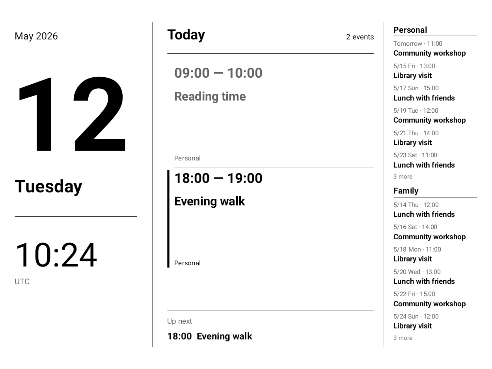
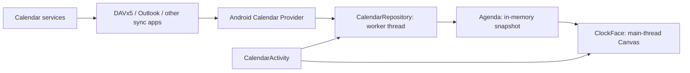

# Daylight · 朝夕

A quiet, high-contrast Android calendar display for e-ink tablets and spare devices.

[中文说明](README.zh-CN.md)



The date and clock sit beside today's agenda and a compact list of upcoming events. Landscape uses three columns; portrait stacks the sections. Upcoming events are grouped under their calendar names, with time-ordered entries in each group, from tomorrow through the next year.

## Features

- Android 8.0+; English and Chinese follow the device language.
- Device time zone, all-day events, overnight events, and recurring instances from Android's calendar provider.
- Calendar selection and automatic, landscape, or portrait orientation.
- Upcoming groups share the available space and show their own remaining-event counts. Calendars without upcoming events are omitted.
- Minute-aligned clock updates. Calendar changes refresh automatically, with a periodic fallback.
- A pixel cat and dog quietly share the display: resting, doing their own thing, reading, playing ball, and occasionally tussling.
- Offline display of cached events, including on battery power.
- One permission: **read calendars**. No network permission, passwords, account login, analytics, or calendar writes.

This is a foreground display app. It keeps the screen awake while open and releases that request when you leave. Pressing the power button or entering real device sleep stops the live display. It does not start automatically after a reboot. Continuous display uses battery; runtime depends on the device and has not been benchmarked.

The companions act automatically—there are no scene buttons. A short scene starts about five seconds after opening; each scene then finishes and holds still for 5–10 minutes. Weighted random choices favour quiet activities, avoid repeating an active scene immediately, and shift toward reading and sleep at night. Black-and-white pixel animation runs in brief bursts at two frames per second and stops when you leave the app.

## Connect calendars

Daylight reads the **Android Calendar Provider**, not cloud services directly:

| Source | How it reaches the device calendar |
| --- | --- |
| iCloud / CalDAV | Configure [DAVx⁵](https://www.davx5.com/), select calendars and enable periodic sync. iCloud requires an [app-specific password](https://support.apple.com/102654). |
| Outlook | In the Android Outlook app, enable **Settings → Calendar → Sync calendars**, where supported by the account and organization policy. |
| Other sources | Use a sync app that populates Android's device calendar provider. |

Install the app, allow calendar access, then tap the display for **Choose calendars**, sync help, orientation, or exit. Account credentials remain in your sync app. Wi-Fi is needed to fetch cloud changes, not to display the clock or cached plans. Manufacturer calendar apps may keep their own private database; seeing events there does not guarantee they are available to Android's calendar provider.

Groups follow the actual device calendar IDs; their headings use the calendar names. They are ordered by each calendar's earliest upcoming event. The app does not infer an event's owner from its title. If a sync app exports several people's events into one calendar, they remain in one group here; separate them in the source calendar or sync configuration if needed.

## BOOX setup

On BOOX, unfreeze Daylight and your sync apps. For the clock, open **long-press app icon → Optimize → Other → Background activity → Always run**. On some firmware, the default time limit blocks Android's keep-screen-on request even when the app is visible. Wording varies by firmware.

Some BOOX firmware can also expire the screen wake lock after prolonged use despite this setting. On devices reporting manufacturer `ONYX`, the app periodically renews its foreground keep-screen-on request. Renewal stops when you leave the app; manual sleep and reboot behavior remain as described above. Renewal has been checked on a Note X with a short sleep timeout and simulated battery power. Overnight stability has not yet been verified.

Turn off the frontlight manually if desired. The app does not change global brightness, sleep timeouts, or power settings. Keep background sync enabled for DAVx⁵/Outlook so new events reach the local calendar.

Developed from a working setup on BOOX Note X, Android 11, firmware 4.2. The generalized layouts and lifecycle are checked with Android rendering tests; other devices have not all been tested physically. E-ink refresh behavior and manufacturer power policies vary. Small phone screens are supported by the layout but are less suited to viewing from a distance.

## Build and install

Use Android Studio, or install **JDK 17**, **Android SDK Platform 35**, and **Build Tools 35.0.0**. Set `ANDROID_HOME`, or create an untracked `local.properties` with `sdk.dir=/path/to/Android/Sdk`.

```sh
./gradlew testDebugUnitTest lintDebug assembleDebug
adb install -r app/build/outputs/apk/debug/app-debug.apk
```

On Windows, use `gradlew.bat`. The Gradle wrapper pins its distribution checksum. GitHub Actions runs tests, lint, and builds, and uploads a debug APK under the workflow run's **Artifacts**. Downloading artifacts requires signing in to GitHub.

`./gradlew assembleRelease` produces an **unsigned**, non-debuggable release APK. Sign it with your own key using Android's signing tools before installing or distributing it. Debug APKs are for evaluation; CI debug signing identities can change between builds. Existing installs require a matching signing key to update. Signing keys and local SDK paths are never checked in.

## Architecture and refresh logic

The app is a single native Java activity with a Canvas view and no runtime third-party libraries. Sync runs in the user's calendar apps; Daylight has no server, background service, or cloud client.



| Component | Responsibility |
| --- | --- |
| [`CalendarActivity`](app/src/main/java/local/boox/calendarclock/CalendarActivity.java) | Permissions, settings, lifecycle, refresh scheduling and foreground power requests. |
| [`CalendarRepository`](app/src/main/java/local/boox/calendarclock/CalendarRepository.java) | Reads visible, selected calendars and expanded recurring instances on one worker thread; returns results to the main thread. Cancelled events are excluded. |
| [`CalendarWindow`](app/src/main/java/local/boox/calendarclock/CalendarWindow.java) | Splits events into today and upcoming windows. Timed events use local midnights; all-day events use UTC calendar dates. Overnight events can appear in both windows. |
| [`Agenda`](app/src/main/java/local/boox/calendarclock/Agenda.java) | Holds the calendar list, events, query window and read status in memory. |
| [`ClockLayout`](app/src/main/java/local/boox/calendarclock/ClockLayout.java) | Defines date, today and upcoming regions for landscape and portrait. |
| [`ClockFace`](app/src/main/java/local/boox/calendarclock/ClockFace.java) | Draws text, event status and calendar groups with uniform scaling and bounded line wrapping. |
| [`CompanionView`](app/src/main/java/local/boox/calendarclock/CompanionView.java) / [`CompanionSchedule`](app/src/main/java/local/boox/calendarclock/CompanionSchedule.java) | Draws the bundled pixel artwork in a separate overlay and chooses scenes by time of day, independently of calendar refreshes. |

The clock redraws just after each minute boundary. Calendar reads happen on resume, after a calendar selection or device time change, and when a new local day or time zone is detected. Provider notifications are debounced by 500 ms; a 15-minute fallback reload covers missed notifications. While a read is running, further requests are combined into one follow-up read. Clock redraws and BOOX power renewal run independently of these reads.

On `ONYX` devices, the foreground screen request is cleared about once a minute and restored 250 ms later, allowing the system to renew its window wake lock. Leaving the activity cancels the timers, unregisters the calendar observer and releases the screen request. This uses standard Android window flags and adds no wake-lock permission.

Calendar events stay in the system provider and the app's in-memory snapshot. Only display orientation, excluded calendar IDs and permission-prompt state are saved in app preferences. Calendar read errors are displayed; the app cannot diagnose or repair upstream sync failures.

Tests cover date boundaries, daylight-saving changes, all-day events, layout bounds, companion scheduling and static holds, and foreground power behavior, including two hours of simulated BOOX renewal and cancellation during pause. Simulated time does not reproduce vendor firmware. Robolectric's native Android rendering produces English, Chinese, portrait and wide-screen previews under `app/build/outputs/previews/`.

[Portrait preview](docs/portrait.png) · [Wide-screen preview](docs/wide-landscape.png)

The screenshots use fictional debug-preview data. No real calendars, account details, device backups or signing keys are included. To render the synthetic preview from a debug build:

```sh
adb shell am force-stop local.boox.calendarclock
adb shell am start -n local.boox.calendarclock/.CalendarActivity --ez preview true --es preview_locale en --es preview_orientation landscape
```

Preview flags are ignored by release builds. Force-stop and launch normally to return to real calendars.

## License

[MIT](LICENSE). Not affiliated with BOOX, Apple, Microsoft, or DAVx⁵.
