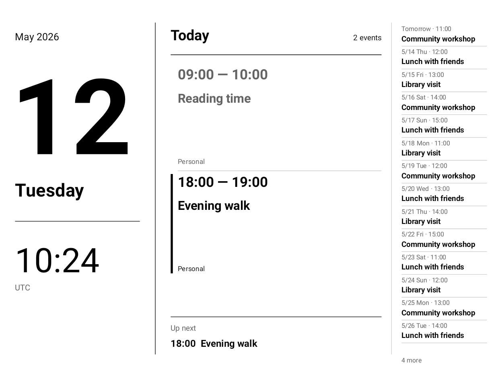

# Calendar Clock

A quiet, high-contrast Android calendar display for e-ink tablets and spare devices.

[中文说明](README.zh-CN.md)



The date and clock sit beside today's agenda and a compact list of upcoming events. Landscape uses three columns; portrait stacks the sections. The upcoming list fills the available space with events from tomorrow through the next year.

## Features

- Android 8.0+; English and Chinese follow the device language.
- Device time zone, all-day events, overnight events, and recurring instances from Android's calendar provider.
- Calendar selection and automatic, landscape, or portrait orientation.
- Minute-aligned clock updates. Calendar changes refresh automatically, with a periodic fallback.
- Offline display of cached events, including on battery power.
- One permission: **read calendars**. No network permission, passwords, account login, analytics, or calendar writes.

This is a foreground display app. It keeps the screen awake while open and releases that request when you leave. Pressing the power button or entering real device sleep stops the live display. It does not start automatically after a reboot. Continuous display uses battery; runtime depends on the device and has not been benchmarked.

## Connect calendars

Calendar Clock reads the **Android Calendar Provider**, not cloud services directly:

| Source | How it reaches the device calendar |
| --- | --- |
| iCloud / CalDAV | Configure [DAVx⁵](https://www.davx5.com/), select calendars and enable periodic sync. iCloud requires an [app-specific password](https://support.apple.com/102654). |
| Outlook | In the Android Outlook app, enable **Settings → Calendar → Sync calendars**, where supported by the account and organization policy. |
| Other sources | Use a sync app that populates Android's device calendar provider. |

Install the app, allow calendar access, then tap the display for **Choose calendars**, sync help, orientation, or exit. Account credentials remain in your sync app. Wi-Fi is needed to fetch cloud changes, not to display the clock or cached plans. Manufacturer calendar apps may keep their own private database; seeing events there does not guarantee they are available to Android's calendar provider.

## BOOX setup

On BOOX, unfreeze Calendar Clock and your sync apps. For the clock, open **long-press app icon → Optimize → Other → Background activity → Always run**. On some firmware, the default time limit blocks Android's keep-screen-on request even when the app is visible. Wording varies by firmware.

Turn off the frontlight manually if desired. The app does not change global brightness, sleep timeouts, or power settings. Keep background sync enabled for DAVx⁵/Outlook so new events reach the local calendar.

Developed from a working setup on BOOX Note X, Android 11, firmware 4.2. The generalized layouts and lifecycle are checked with Android rendering tests; other devices have not all been tested physically. E-ink refresh behavior and manufacturer power policies vary. Small phone screens are supported by the layout but are less suited to viewing from a distance.

## Build and install

Use Android Studio, or install **JDK 17**, **Android SDK Platform 35**, and **Build Tools 35.0.0**. Set `ANDROID_HOME`, or create an untracked `local.properties` with `sdk.dir=/path/to/Android/Sdk`.

```sh
./gradlew testDebugUnitTest lintDebug assembleDebug
adb install -r app/build/outputs/apk/debug/app-debug.apk
```

On Windows, use `gradlew.bat`. The Gradle wrapper pins its distribution checksum. GitHub Actions runs tests, lint, and builds, and uploads a debug APK under the workflow run's **Artifacts**. Downloading artifacts requires signing in to GitHub.

`./gradlew assembleRelease` produces an **unsigned**, non-debuggable release APK. Sign it with your own key using Android's signing tools before installing or distributing it. Debug APKs are for evaluation; CI debug signing identities can change between builds. Existing installs require a matching signing key to update. Signing keys and local SDK paths are never checked in.

## Implementation

The app is native Java with a Canvas view and no runtime third-party libraries. `CalendarRepository` reads expanded event instances; `CalendarWindow` handles local-day and UTC all-day boundaries; `ClockFace` renders uniformly scaled text without stretching it; `CalendarActivity` owns permissions, lifecycle, refresh scheduling, and settings.

Calendar data is queried when the app opens, the provider changes, the day or time zone changes, or the fallback interval elapses. The minute timer redraws the clock without re-querying a year of events every minute. Tests cover date boundaries, daylight-saving changes, all-day events, layout bounds, and foreground power behavior. Robolectric's native Android rendering produces English, Chinese, portrait and wide-screen previews under `app/build/outputs/previews/`.

[Portrait preview](docs/portrait.png) · [Wide-screen preview](docs/wide-landscape.png)

The screenshots use fictional debug-preview data. No real calendars, account details, device backups or signing keys are included. To render the synthetic preview from a debug build:

```sh
adb shell am force-stop local.boox.calendarclock
adb shell am start -n local.boox.calendarclock/.CalendarActivity --ez preview true --es preview_locale en --es preview_orientation landscape
```

Preview flags are ignored by release builds. Force-stop and launch normally to return to real calendars.

## License

[MIT](LICENSE). Not affiliated with BOOX, Apple, Microsoft, or DAVx⁵.
