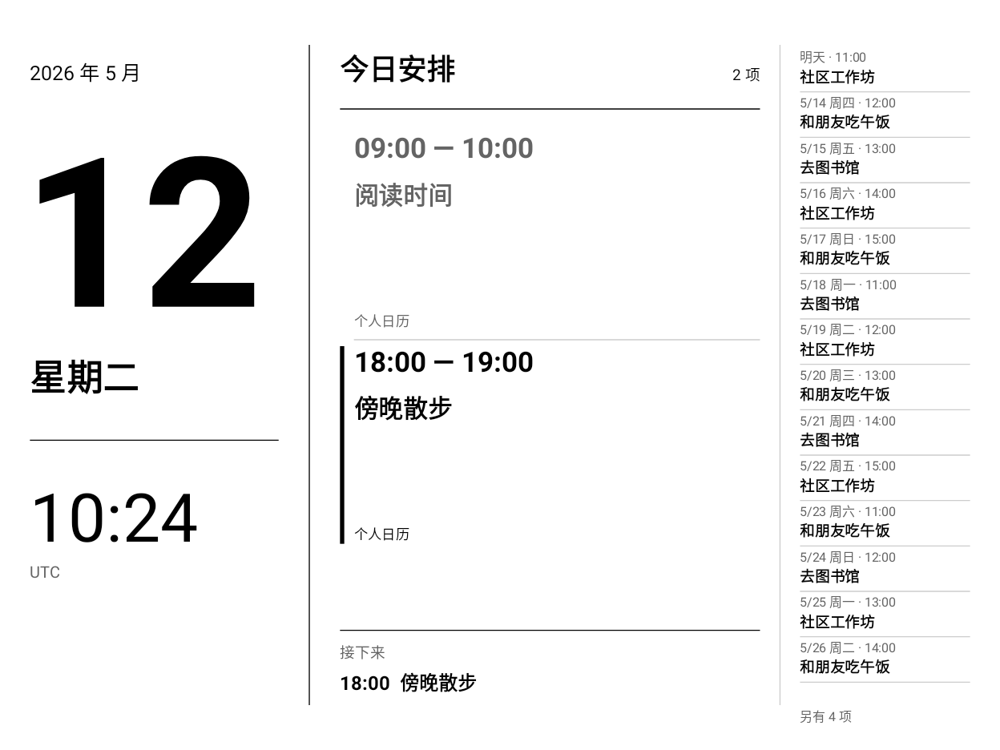

# 日历钟

适合墨水屏和平板的安卓日历展示应用：大日期、时间、今日安排，以及紧凑的后续日程。

[English](README.md)



## 使用

支持 Android 8.0 及以上，界面跟随系统使用中文或英文，时间跟随设备时区。横屏使用三栏，竖屏分区显示。后续安排按时间排序，从明日起查询未来一年内已同步的日程，按可用空间尽量显示。

应用只读取**安卓系统日历**：

- iCloud / CalDAV：用 [DAVx⁵](https://www.davx5.com/) 登录、勾选日历并开启周期同步。iCloud 使用 Apple 的 [App 专用密码](https://support.apple.com/102654)。
- Outlook：在安卓 Outlook 中开启「设置 → 日历 → 同步日历」，可用性取决于账号与组织策略。
- 其他来源：只要同步应用能将数据写入安卓系统日历，就能显示。厂商日历中的私有数据不一定能被读取。

安装后允许读取日历，轻触画面可选择日历来源、查看同步说明、切换显示方向或退出。日历钟没有联网权限，不接触云端账号密码，不修改日程，不包含统计或广告服务。

## 电池、离线与 BOOX

电池供电和离线都能显示时钟及已缓存日程；云端新增或修改的日程需联网同步后才会出现。应用在前台时保持屏幕唤醒，离开应用后释放。按电源键真正休眠后不会继续走时，重启后需要重新打开。持续显示会消耗电池，真实续航取决于设备，尚未测量。

BOOX 用户请解冻日历钟及同步应用，并为日历钟设置「长按图标 → 优化 → 其它 → 后台持续运行 → 持续运行」。部分固件默认的时限会拒绝应用的保持唤醒请求，具体名称可能不同。需要时手动关闭前光，允许 DAVx⁵ / Outlook 后台同步。

基于 BOOX Note X、Android 11、4.2 固件上的可用方案开发。通用布局和前后台行为通过安卓渲染测试检查，其他设备尚未逐一实测；墨水屏刷新方式与厂商电源管理可能不同。应用不会修改系统休眠时间或全局亮度。

## 构建

使用 Android Studio，或准备 JDK 17、Android SDK Platform 35 和 Build Tools 35.0.0。设置 `ANDROID_HOME`，或在不提交到 Git 的 `local.properties` 中指定 `sdk.dir`。

```sh
./gradlew testDebugUnitTest lintDebug assembleDebug
adb install -r app/build/outputs/apk/debug/app-debug.apk
```

Windows 使用 `gradlew.bat`。GitHub Actions 会运行测试、Lint 和构建，调试 APK 在工作流运行页面的 Artifacts 中，下载需登录 GitHub。调试 APK 适合体验；不同 CI 构建的调试签名可能不同，已有安装必须使用相同签名才能覆盖升级。

`assembleRelease` 生成未签名、不可调试的正式构建，需要使用自己的密钥签名后分发。请勿提交签名文件、私人日历、设备备份或真实账号截图。

代码使用原生 Java、Canvas、Calendar Provider，没有运行时第三方库。界面每分钟更新，日历数据在来源变化、日期/时区变化及定期检查时重新读取。测试覆盖时区、全天事件、跨天安排、夏令时、布局边界及前后台电源行为。Robolectric 安卓原生渲染测试会在 `app/build/outputs/previews/` 生成中英文、竖屏和宽屏预览，全部使用虚构数据。

[竖屏预览](docs/portrait.png) · [宽屏预览](docs/wide-landscape.png)

采用 [MIT 许可证](LICENSE)，与 BOOX、Apple、Microsoft、DAVx⁵ 无隶属关系。
