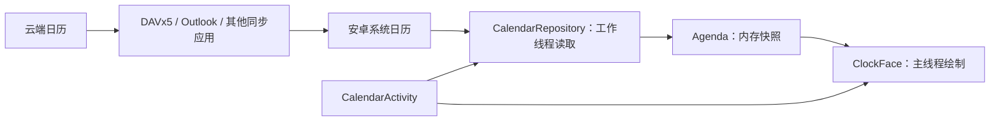

# 朝夕 · Daylight

适合墨水屏和平板的安卓日历展示应用：大日期、时间、今日安排，以及紧凑的后续日程。

[English](README.md)


## 使用

支持 Android 8.0 及以上，界面跟随系统使用中文或英文，时间跟随设备时区。横屏使用三栏，竖屏分区显示。后续安排从明日起查询未来一年内已同步的日程，按日历名称分组，组内按时间排序。各组分配显示空间，分别提示未展开的数量；没有后续安排的日历不显示。

应用只读取**安卓系统日历**：

- iCloud / CalDAV：用 [DAVx⁵](https://www.davx5.com/) 登录、勾选日历并开启周期同步。iCloud 使用 Apple 的 [App 专用密码](https://support.apple.com/102654)。
- Outlook：在安卓 Outlook 中开启「设置 → 日历 → 同步日历」，可用性取决于账号与组织策略。
- 其他来源：只要同步应用能将数据写入安卓系统日历，就能显示。厂商日历中的私有数据不一定能被读取。

安装后允许读取日历，轻触画面可选择日历来源、查看同步说明、切换显示方向或退出。朝夕没有联网权限，不接触云端账号密码，不修改日程，不包含统计或广告服务。

日期旁住着一只像素猫和一只垂耳狗，会自动休息、各玩各的、一起看书、玩球，偶尔轻轻打闹，无需点击场景按钮。打开约 5 秒后开始一段活动，每段播完后静止 5–10 分钟，再按权重随机选择；安静的场景更常见，活动场景不连续重复，夜间只休息或看书。黑白像素动画以每秒 2 帧短暂播放，离开应用后停止。

分组依据是设备中的真实日历 ID，标题使用日历名称，各组按最早一项后续安排排序。应用不会根据日程标题推断所属人。如果同步应用把多个人的安排导入同一本日历，它们在这里仍属于同一组；需要区分时，应在来源日历或同步配置中拆分。

## 电池、离线与 BOOX

电池供电和离线都能显示时钟及已缓存日程；云端新增或修改的日程需联网同步后才会出现。应用在前台时保持屏幕唤醒，离开应用后释放。按电源键真正休眠后不会继续走时，重启后需要重新打开。持续显示会消耗电池，真实续航取决于设备，尚未测量。

BOOX 用户请解冻朝夕及同步应用，并为朝夕设置「长按图标 → 优化 → 其它 → 后台持续运行 → 持续运行」。部分固件默认的时限会拒绝应用的保持唤醒请求，具体名称可能不同。需要时手动关闭前光，允许 DAVx⁵ / Outlook 后台同步。

部分 BOOX 固件即使开启「持续运行」，仍会在长时间运行后释放屏幕唤醒锁。因此，应用会在厂商标识为 `ONYX` 的设备上定期续期前台保持唤醒请求，离开应用后停止。已在 Note X 上用短自动休眠时间和模拟电池供电验证续期；尚未完成整夜稳定性实测。主动休眠和重启的使用限制仍适用。

基于 BOOX Note X、Android 11、4.2 固件上的可用方案开发。通用布局和前后台行为通过安卓渲染测试检查，其他设备尚未逐一实测；墨水屏刷新方式与厂商电源管理可能不同。应用不会修改系统休眠时间或全局亮度。

## 构建

使用 Android Studio，或准备 JDK 17、Android SDK Platform 35 和 Build Tools 35.0.0。设置 `ANDROID_HOME`，或在不提交到 Git 的 `local.properties` 中指定 `sdk.dir`。

```sh
./gradlew testDebugUnitTest lintDebug assembleDebug
adb install -r app/build/outputs/apk/debug/app-debug.apk
```

Windows 使用 `gradlew.bat`。GitHub Actions 会运行测试、Lint 和构建，调试 APK 在工作流运行页面的 Artifacts 中，下载需登录 GitHub。调试 APK 适合体验；不同 CI 构建的调试签名可能不同，已有安装必须使用相同签名才能覆盖升级。

`assembleRelease` 生成未签名、不可调试的正式构建，需要使用自己的密钥签名后分发。请勿提交签名文件、私人日历、设备备份或真实账号截图。

## 架构与刷新逻辑

应用由一个原生 Java Activity 和 Canvas 视图组成，没有运行时第三方库。同步由用户配置的日历应用完成，朝夕没有服务端、后台服务或云端客户端。



| 模块 | 职责 |
| --- | --- |
| [`CalendarActivity`](app/src/main/java/local/boox/calendarclock/CalendarActivity.java) | 管权限、设置、生命周期、刷新定时器和前台保持唤醒。 |
| [`CalendarRepository`](app/src/main/java/local/boox/calendarclock/CalendarRepository.java) | 在单一工作线程读取可见且选中的日历及已展开的重复日程，排除已取消事件，再把结果交回主线程。 |
| [`CalendarWindow`](app/src/main/java/local/boox/calendarclock/CalendarWindow.java) | 划分今日和后续时间窗口。计时事件按本地午夜计算，全天事件按 UTC 日期计算；跨午夜的事件可同时出现在两个窗口中。 |
| [`Agenda`](app/src/main/java/local/boox/calendarclock/Agenda.java) | 保存日历列表、事件、查询窗口和读取状态的内存快照。 |
| [`ClockLayout`](app/src/main/java/local/boox/calendarclock/ClockLayout.java) | 计算横屏、竖屏下日期、今日和后续安排的区域。 |
| [`ClockFace`](app/src/main/java/local/boox/calendarclock/ClockFace.java) | 绘制日期、事件状态和日历分组，处理等比例缩放、换行和截断。 |
| [`CompanionView`](app/src/main/java/local/boox/calendarclock/CompanionView.java) / [`CompanionSchedule`](app/src/main/java/local/boox/calendarclock/CompanionSchedule.java) | 在独立图层绘制内置像素猫狗，按时段选择场景，与日历刷新独立运行。 |

时钟在每个整分钟之后重绘。日历数据在应用回到前台、选择日历或设备时间变化后重新读取；检测到跨日或时区变化时也会重读。系统日历变更通知合并等待 500 毫秒后读取，另有每 15 分钟一次的补查。读取进行中收到的新请求会合并成一次后续读取，时钟重绘和 BOOX 唤醒续期独立运行。

在 `ONYX` 设备上，应用约每分钟清除一次窗口的保持唤醒标志，250 毫秒后恢复，让系统重新取得屏幕唤醒锁。离开 Activity 时取消定时回调、注销日历监听并释放保持唤醒请求。使用的是标准安卓窗口接口，没有增加唤醒锁权限。

日程保留在系统日历和应用的内存快照中；应用设置只保存显示方向、排除的日历 ID 和权限提示状态。读取失败会显示错误，但应用无法诊断或修复上游同步故障。

测试覆盖日期边界、夏令时、全天事件、布局边界、猫狗场景调度与静止间隔及前后台电源行为，也覆盖模拟运行两小时的 BOOX 续期和切后台时取消续期。模拟时间不能代替厂商固件实测。Robolectric 安卓原生渲染测试会在 `app/build/outputs/previews/` 生成中英文、竖屏和宽屏预览，全部使用虚构数据。

[竖屏预览](docs/portrait.png) · [宽屏预览](docs/wide-landscape.png)

采用 [MIT 许可证](LICENSE)，与 BOOX、Apple、Microsoft、DAVx⁵ 无隶属关系。
